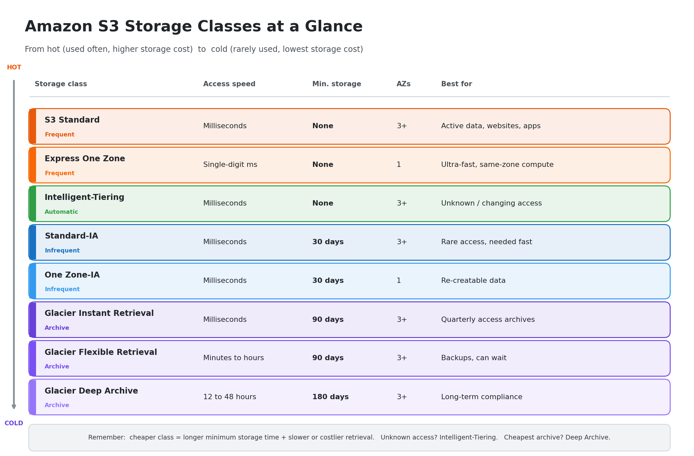

# S3 Storage Classes: Complete Study Notes

A plain-English guide to Amazon S3 storage classes, minimum storage time, Intelligent-Tiering, and lifecycle policies. Useful for AWS Cloud Practitioner exam prep.

## Summary image

*Keep `s3-storage-classes-summary.png` in the same folder as this file so the image shows up.*

## Table of contents

1. [The big picture](#1-the-big-picture)
2. [Group 1: Frequent access](#2-group-1-frequent-access)
3. [Group 2: Automatic (Intelligent-Tiering)](#3-group-2-automatic-intelligent-tiering)
4. [Group 3: Infrequent access](#4-group-3-infrequent-access)
5. [Group 4: Archive (Glacier family)](#5-group-4-archive-glacier-family)
6. [Side-by-side comparison](#6-side-by-side-comparison)
7. [What is minimum storage time?](#7-what-is-minimum-storage-time)
8. [S3 Lifecycle policy](#8-s3-lifecycle-policy)
9. [How to choose](#9-how-to-choose)
10. [Exam tips](#10-exam-tips)

---

## 1. The big picture

Every object in S3 sits in a **storage class**. They trade off three things:

1. **Cost:** price per GB stored
2. **Access speed and retrieval cost:** how fast and how expensive it is to get data back
3. **Resilience:** how many data centers (Availability Zones) hold your data

Cheaper storage usually means a retrieval fee, a minimum storage time, or slower access. The classes fall into four groups: **frequent access**, **automatic**, **infrequent access**, and **archive**.

All classes (except Express One Zone) are designed for **99.999999999% durability** ("11 nines"). That means data is very unlikely to be lost. What changes between classes is availability, speed, and cost.

---

## 2. Group 1: Frequent access

### S3 Standard

The default class and the "everyday" option.

- **Best for:** active data, websites, apps, mobile and gaming content, big data analytics
- **Speed:** milliseconds
- **Resilience:** stored across **3 or more Availability Zones**
- **Availability:** 99.99%
- **Retrieval fee:** none
- **Minimum storage time:** none
- **Cost:** the highest storage price of the main classes, but no extra fees for reading data

**Example:** product images on an online shop, read thousands of times a day.

### S3 Express One Zone

A newer class built for **speed**.

- **Best for:** latency-sensitive workloads, such as machine learning training, real-time analytics, and data read very often by compute in the same zone
- **Speed:** single-digit milliseconds, the fastest S3 class
- **Resilience:** stored in **one AZ you choose**, so you can place it next to your compute
- **Uses directory buckets**, a special bucket type
- **Trade-off:** if that AZ is lost, your data could be lost

**Example:** an ML job that reads the same training dataset millions of times and needs the lowest possible delay.

---

## 3. Group 2: Automatic (Intelligent-Tiering)

Group 2 has just one storage class: **S3 Intelligent-Tiering**. It's called "automatic" because **S3 decides where your data should live**, based on how often you actually use it. You don't set rules or timers.

### Simple real-life example

Think of a **smart closet** that watches what you wear.

- Clothes you wear every week stay at the front
- Clothes you haven't touched for a month get moved to the back
- Clothes untouched for months go to a box in storage
- The moment you wear something again, it jumps back to the front

You never organize it yourself. The closet does it for you, and you pay a small fee for that service.

### How it works

Every object starts in the **Frequent Access** tier. Then S3 tracks it:

| If the object is not accessed for... | It moves to... | Notes |
|--------------------------------------|----------------|-------|
| Starts here | **Frequent Access tier** | Same price as Standard |
| 30 days | **Infrequent Access tier** | Cheaper |
| 90 days | **Archive Instant Access tier** | Even cheaper, still instant |
| 90+ days (optional) | **Archive Access tier** | You must turn this on; slower retrieval |
| 180+ days (optional) | **Deep Archive Access tier** | You must turn this on; cheapest, slowest |

**If you access the object again,** it automatically moves back to the Frequent Access tier, and the clock restarts.

### AWS example

Say you run a **data lake** where analysts upload datasets. Nobody can predict which ones will be needed again.

- Dataset A is used daily, so it stays in **Frequent Access**
- Dataset B hasn't been touched in 40 days, so S3 moves it to **Infrequent Access** and your cost drops
- Dataset B is suddenly needed for a report, so S3 moves it back to **Frequent Access** with **no retrieval fee**

Without Intelligent-Tiering, you'd have to guess and write lifecycle rules, and a wrong guess could cost you retrieval fees.

### Costs to know

- **No retrieval fees** when objects move between tiers or are accessed
- **No minimum storage time**
- **A small monitoring and automation fee per object**, which is how AWS charges for the "smart" part
- **Objects under 128 KB** aren't monitored or moved, so they stay in the Frequent tier and you don't pay the monitoring fee for them

### Intelligent-Tiering vs. lifecycle policy

| | Lifecycle policy | Intelligent-Tiering |
|---|------------------|---------------------|
| Who decides? | **You** set rules by age | **AWS** watches actual access |
| Moves data back up when accessed? | No | **Yes** |
| Best when | You know the access pattern | The access pattern is unknown or changing |
| Extra fee | None for the rule | Per-object monitoring fee |

### When to use it

- Access patterns are **unknown, unpredictable, or changing**
- You want savings **without guessing** or managing rules
- You have **long-lived** data (not files deleted within days)

It is not ideal if you have millions of **tiny objects**, because the per-object monitoring fee can outweigh the savings.

---

## 4. Group 3: Infrequent access

These are for data you don't read often but need **quickly** when you do. Storage is cheaper than Standard, but you pay a **retrieval fee per GB**.

### S3 Standard-IA (Infrequent Access)

- **Best for:** long-lived data accessed rarely, such as backups and older records
- **Speed:** milliseconds
- **Resilience:** **3 or more AZs**
- **Availability:** 99.9%
- **Minimum storage time:** **30 days**
- **Minimum billable size:** 128 KB per object
- **Retrieval fee:** yes

**Example:** last quarter's database backups. You rarely need them, but when you do, you need them now.

### S3 One Zone-IA

Like Standard-IA, but stored in **only one AZ**.

- **Best for:** **re-creatable** or secondary copies of data
- **Cost:** about 20% cheaper than Standard-IA
- **Availability:** 99.5%
- **Minimum storage time:** 30 days
- **Trade-off:** if that AZ is destroyed, the data is lost

**Example:** thumbnail images that you can regenerate from the original photos.

---

## 5. Group 4: Archive (Glacier family)

These are for data you keep for a long time and almost never read. They are the cheapest classes, and access gets slower as you go cheaper.

### S3 Glacier Instant Retrieval

- **Best for:** archive data that is rarely accessed (about once a quarter) but must be available **instantly**
- **Speed:** milliseconds
- **Resilience:** 3 or more AZs
- **Availability:** 99.9%
- **Minimum storage time:** **90 days**
- **Retrieval fee:** yes, higher than Standard-IA

**Example:** medical images or news media archives that are rarely viewed but must open right away when needed.

### S3 Glacier Flexible Retrieval

Formerly just "S3 Glacier."

- **Best for:** backups and archives where you can **wait** for data
- **Retrieval options:**
  - **Expedited:** about 1 to 5 minutes
  - **Standard:** about 3 to 5 hours
  - **Bulk:** about 5 to 12 hours, the cheapest and free of per-GB retrieval charges
- **Minimum storage time:** **90 days**
- **Resilience:** 3 or more AZs

**Example:** yearly financial records you'd only retrieve for an audit, where waiting a few hours is fine.

### S3 Glacier Deep Archive

The **cheapest** storage in all of AWS.

- **Best for:** long-term retention, such as compliance data kept 7 to 10 years or more, and data almost never accessed
- **Retrieval options:**
  - **Standard:** within about 12 hours
  - **Bulk:** within about 48 hours
- **Minimum storage time:** **180 days**
- **Resilience:** 3 or more AZs

**Example:** legal or healthcare records that regulations require you to keep for a decade.

---

## 6. Side-by-side comparison

| Class | Access speed | AZs | Min. storage time | Retrieval fee | Best for |
|-------|--------------|-----|-------------------|---------------|----------|
| **Standard** | Milliseconds | 3+ | None | No | Active data |
| **Express One Zone** | Single-digit ms | 1 | None | No | Ultra-fast, same-zone compute |
| **Intelligent-Tiering** | Milliseconds (frequent to archive instant tiers) | 3+ | None | No | Unknown access patterns |
| **Standard-IA** | Milliseconds | 3+ | 30 days | Yes | Rare access, must be fast |
| **One Zone-IA** | Milliseconds | 1 | 30 days | Yes | Re-creatable data |
| **Glacier Instant Retrieval** | Milliseconds | 3+ | 90 days | Yes | Quarterly access archives |
| **Glacier Flexible Retrieval** | Minutes to hours | 3+ | 90 days | Yes | Backups, wait is OK |
| **Glacier Deep Archive** | Hours (12 to 48) | 3+ | 180 days | Yes | Long-term compliance |

---

## 7. What is minimum storage time?

**Minimum storage time** is the shortest period AWS will charge you for an object in a storage class, even if you delete or move it sooner.

If you store a file in Standard-IA (30-day minimum) and delete it after 5 days, you still pay for the full 30 days.

### Simple real-life example

Think of **renting a storage unit** with a 3-month minimum contract.

- You rent it, then decide after 1 month that you don't need it
- You can move out whenever you like, but you still pay for the full 3 months

S3 works the same way. You're free to delete or move the object early, but the bill covers the minimum period.

### AWS example

Say you upload a 10 GB file to **S3 Standard-IA** (30-day minimum):

| What you do | What you pay for |
|-------------|------------------|
| Keep it 45 days, then delete | 45 days of storage |
| Delete it after 10 days | **30 days** of storage (the minimum) |
| Move it to Glacier after 5 days | **30 days** in Standard-IA, then Glacier charges begin |

### Minimum storage time by class

| Class | Minimum storage time |
|-------|----------------------|
| Standard | None |
| Express One Zone | None |
| Intelligent-Tiering | None |
| Standard-IA | 30 days |
| One Zone-IA | 30 days |
| Glacier Instant Retrieval | 90 days |
| Glacier Flexible Retrieval | 90 days |
| Glacier Deep Archive | 180 days |

The cheaper the class, the longer the minimum. AWS is betting you'll keep the data there for a long time.

### Why it matters

- **Don't use cheap classes for short-lived data.** If files are deleted after a week, Standard is often cheaper overall than Standard-IA, because you'd pay the 30-day minimum anyway.
- **Be careful with lifecycle rules.** If a rule moves objects to Glacier Deep Archive and then deletes them after 30 days, you still pay for 180 days.
- **Frequent changes cost money.** Moving objects between classes too quickly wastes the minimum period of each class.

### Don't confuse it with minimum billable size

Some classes (like Standard-IA) also have a **minimum billable object size of 128 KB**. A 10 KB file is billed as if it were 128 KB. That is about *size*, not *time*.

---

## 8. S3 Lifecycle policy

An **S3 Lifecycle policy** is a set of rules that tells S3: *"After X days, automatically move or delete these files."* You don't have to do anything by hand. S3 follows the rules on its own, which saves you money.

### Why it exists

Most data is used a lot when it's new, then hardly ever touched. A lifecycle policy moves old data to cheaper storage classes as it ages.

### The two types of actions

1. **Transition:** move objects to a cheaper storage class (e.g., Standard to Standard-IA to Glacier)
2. **Expiration:** delete objects after a set time

### Simple real-life example

Think of your **phone's photos**:

- Recent photos stay on your phone (fast and easy to reach)
- After a few months, you move them to a cheap external drive
- After years, you put them in a box in the attic
- Eventually, you throw away the ones you don't need

A lifecycle policy does this for your S3 files.

### AWS example: application log files

Say your app writes log files to S3 every day. You set up these rules:

| When | What happens | Storage class |
|------|--------------|---------------|
| Day 0 | Log is uploaded | **S3 Standard** |
| Day 30 | Moved automatically | **S3 Standard-IA** (cheaper, for infrequent access) |
| Day 90 | Moved automatically | **S3 Glacier** (very cheap archive) |
| Day 365 | Deleted automatically | Gone |

Nobody has to remember to clean up. Your storage bill drops, and old logs don't pile up forever.

### Other useful things lifecycle rules can do

- **Apply to part of a bucket:** use a prefix (like `logs/`) or tags, so different folders get different rules
- **Handle versioning:** delete or archive *old versions* of files (noncurrent versions)
- **Clean up failed uploads:** remove incomplete multipart uploads that waste space

### Good to know

- Lifecycle rules are **free to set up**, but you pay for the storage classes and any transition requests.
- Objects move **down** the cost ladder (Standard to IA to Glacier), not back up automatically.
- Some classes have **minimum storage times**, so moving files too early can waste money.

---

## 9. How to choose

- **Used all the time?** Standard
- **Need the absolute fastest speed in one zone?** Express One Zone
- **Don't know how often it's used?** Intelligent-Tiering
- **Rare access, but needed instantly?** Standard-IA, or Glacier Instant Retrieval if it's even rarer
- **Can recreate the data and want to save money?** One Zone-IA
- **Archive, and you can wait minutes to hours?** Glacier Flexible Retrieval
- **Keep for years, almost never touch?** Glacier Deep Archive

---

## 10. Exam tips

- "**Unknown or changing access patterns**" or "**automatically optimize costs**" points to **Intelligent-Tiering**.
- "**Cheapest long-term archive**" points to **Glacier Deep Archive**.
- "**Single AZ**" classes (One Zone-IA, Express One Zone) are riskier, so the answer is rarely one of them if the question mentions high availability or resilience.
- "**Archive but needs instant access**" points to **Glacier Instant Retrieval**.
- **Lifecycle policies** are how you move objects between these classes automatically, while **Intelligent-Tiering** lets AWS do it based on real usage.
- Minimum storage times: **30 days** (Standard-IA, One Zone-IA), **90 days** (Glacier Instant and Flexible), **180 days** (Deep Archive).

The numbers above (minimum days, retrieval times, availability) are the commonly tested ones. AWS occasionally updates pricing and details, so check the official S3 storage classes page before relying on exact figures for real projects.

---

## One-line summary

> **S3 storage classes let you pay less for data you use less: keep hot data in Standard, let Intelligent-Tiering or lifecycle policies move it down as it cools, and watch the minimum storage times so early moves don't cost extra.**
